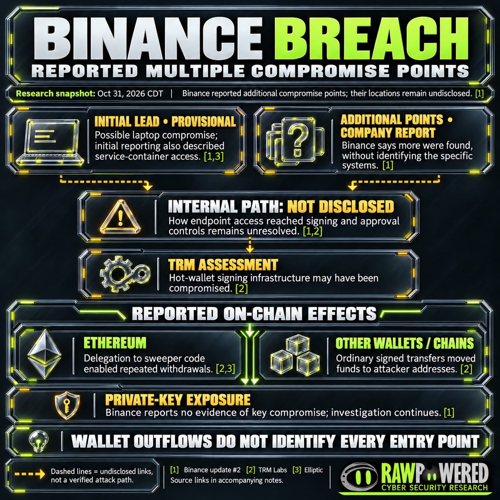
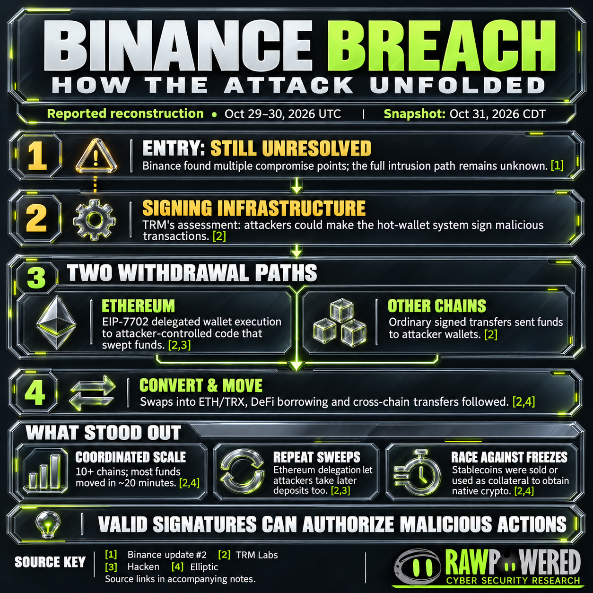
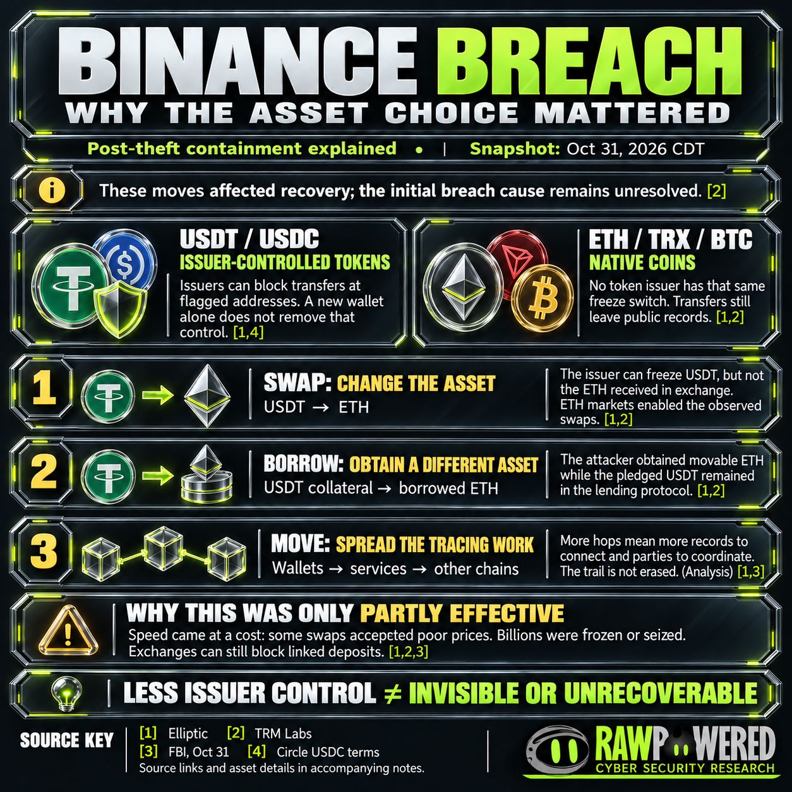

# Binance breach — four-graphic exploration

**Snapshot: October 31, 2026 CDT.** These AI-assisted editorial graphics explain the cited research. They are separate from authentic [source screenshots](research/VISUAL-EVIDENCE.md). Source numbering is local to each graphic; use its companion notes to resolve the key.

## 1. Research cover

**Caption:** The attack, the assets and the recovery — an independent cybersecurity and cryptocurrency case study. The cover is conceptual illustration, not an official Binance announcement. The emblem reference came from the [Binance Style Guide](https://design.binance.vision/882e92a34/p/001e0b-binance-style-guide), linked by the [official newsroom](https://www.binance.com/en-GB/press). Binance and RawPowered marks retain their respective identities.

## 2. Reported multiple compromise points

**Caption:** Separate the initial lead, the company's broader statement, the investigator's assessment and the wallet effects. The diagram does not identify undisclosed systems or claim exactly two entry points. Dashed lines indicate unresolved links. [Source key, qualifications and alt text](visuals/compromise-points.md).

## 3. How the attack unfolded

**Caption:** A conceptual sequence rather than a timestamped proof of the internal attack path. Ethereum delegation was one observed technique; another Ethereum wallet also made ordinary transfers. [Source key, qualifications and alt text](visuals/attack-mechanics.md).

## 4. Why asset choice mattered

**Caption:** Post-theft asset handling affected containment and tracing. Absence of a token-issuer blocklist does not imply anonymity or immunity from custody seizure, exchange screening or other intervention. BTC was stolen directly; the graphic does not claim all BTC came from swaps. [Source key, qualifications and alt text](visuals/asset-choice.md).

[Return to the overview](README.md) · [Full dossier](research/DOSSIER.md) · [Source evidence](research/VISUAL-EVIDENCE.md)
