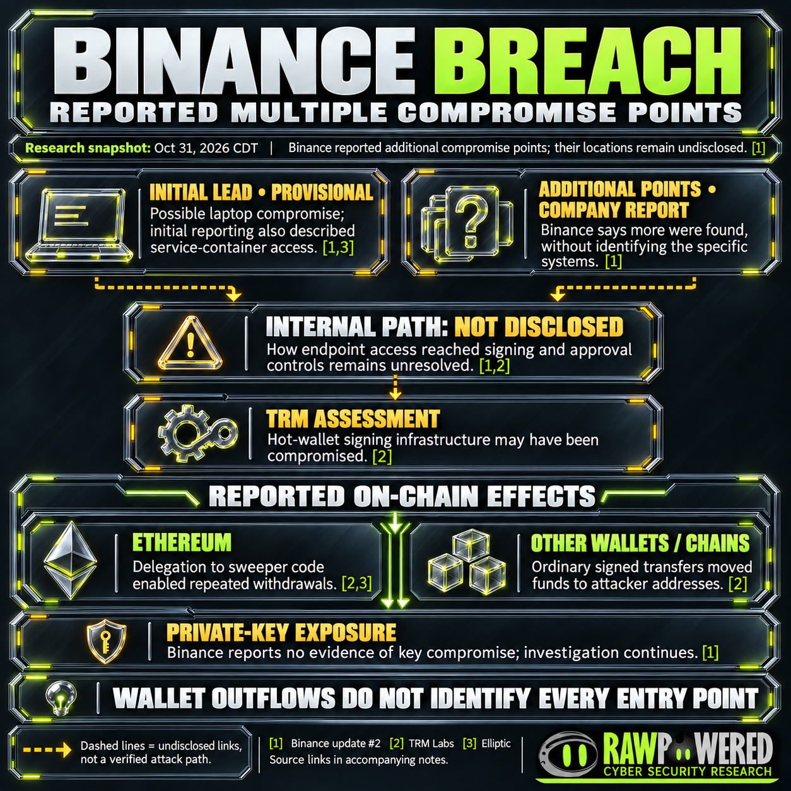
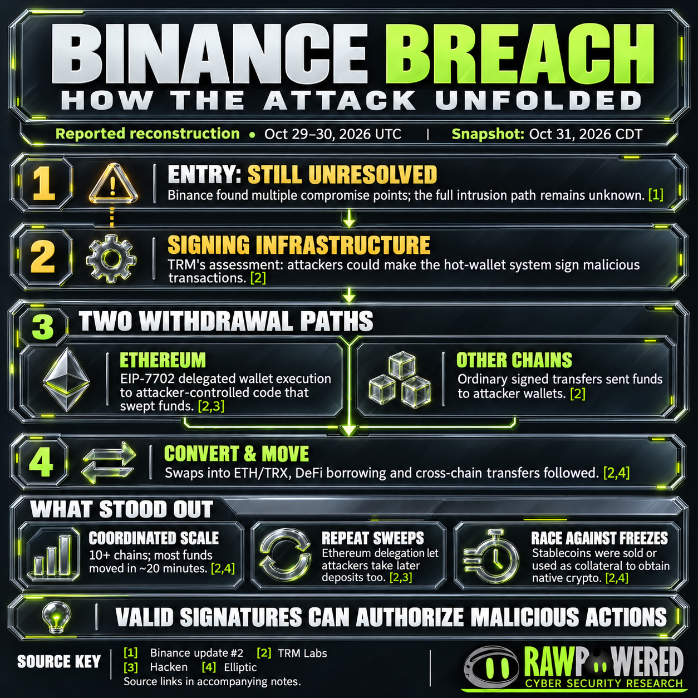
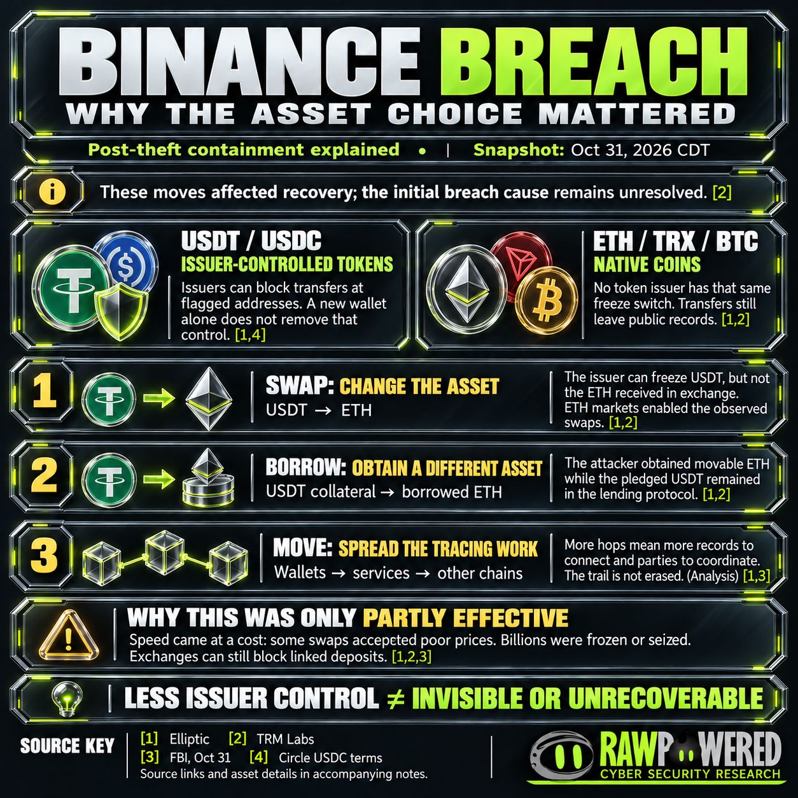

# Binance Breach Research

**Independent research by RawPowered on the October 29, 2026 Binance hot-wallet theft and its attribution to North Korea's TraderTraitor activity.**

**Original snapshot: October 31, 2026. Latest evidence review: November 2, 2026 (America/Chicago).** The [November 2 update](updates/2026-11-02/README.md) adds four citations and two revised source versions while preserving the original dossier and graphics.

**Latest reported developments:** phased withdrawal reopening, 95% replacement coverage and completion of a reserve proof for ten assets. These are attributed reports, not this project's independent verification of reserves or complete service restoration. [Evidence and limitations](updates/2026-11-02/README.md).

Binance reported roughly $6.3B in losses. The FBI's October 31 alert attributed the theft to North Korea's TraderTraitor activity. The internal intrusion route remained unresolved in the reviewed evidence. [Company statement](https://www.binance.com/en/square/post/382966352206379) · [FBI attribution](https://www.fbi.gov/investigate/cyber/alerts/2026/north-korea-responsible-for-6-billion-binance-attack)

## Start with the evidence

| Read | What it contains |
|---|---|
| [November 2 evidence update](updates/2026-11-02/README.md) | New citations, revised tracing, operational milestones and claim follow-up |
| [Full research dossier](research/DOSSIER.md) | Attack mechanics, attribution, financial accounting, response and open questions |
| [Four-graphic guide](GALLERY.md) | The cover, reported compromise points, attack sequence and asset-choice explanation, with captions and citations |
| [Annotated source evidence](research/VISUAL-EVIDENCE.md) | Three source-page screenshots and three original data/concept graphics |
| [Sources](SOURCES.md) | Sixteen original dossier resources, four added references, two revised versions and supplementary visual references |
| [Claim audit](research/claim-audit.csv) | Thirteen claims with status boundaries |

## The visual exploration

Select a preview for the full-resolution graphic. The [visual guide](GALLERY.md) provides readable full-width versions and the source keys used on each image.

| Reported compromise points | How the attack unfolded | Why asset choice mattered |
|---|---|---|
|  |  |  |
| [Sources and alt text](visuals/compromise-points.md) | [Sources and alt text](visuals/attack-mechanics.md) | [Sources and alt text](visuals/asset-choice.md) |

## What the case distinguishes

- **Company reports, investigator assessments and observed wallet actions.** Additional compromise points were reported but not identified in the reviewed statement; wallet outflows do not supply a complete internal intrusion map.
- **Theft, frozen assets, returned assets and replacement funding.** These are different accounting questions. Source estimates overlap and have different cutoffs.
- **Issuer-controlled tokens and native coins.** Converting or borrowing changed which asset the attacker held and which controls applied; transaction history remained available for investigation.
- **Automation and AI attribution.** Automation alone does not establish AI use. AI involvement remains unconfirmed in the archived evidence.

The supporting analysis and citations are in the [dossier](research/DOSSIER.md). The graphics summarize that record and do not add new forensic findings.

## Structured research

| Dataset | Archived observations |
|---|---:|
| [Timeline](research/timeline.csv) | 18 dated events, observations and targets |
| [Financial estimates](research/financial-estimates.csv) | 15 separately scoped observations |
| [Claim audit](research/claim-audit.csv) | 13 claim assessments |
| [Source register](research/source-register.csv) | 16 resources |

Future commitments in the original timeline remain targets in that snapshot. Later observations and milestone reports are recorded separately in the [update datasets](updates/2026-11-02/README.md#read-the-update-data).

## Scope and provenance

This compilation uses public owner statements, official attribution, published blockchain investigations, protocol documentation and selected reporting. It does not include internal incident logs or claim an independent chain replay, reserve audit or forensic attribution.

Authentic source-page captures and original data charts are labeled in the [evidence archive](research/VISUAL-EVIDENCE.md). The four glass-series graphics are AI-assisted editorial illustrations, separately documented in the [visual guide](GALLERY.md). Their appearance is not evidence of incident facts.

Read the [publication record](PUBLICATION.md) for preservation and source-access notes, the [reuse and attribution notes](RIGHTS.md) for third-party material, or the [plain-text citations](CITATIONS.txt) for sharing.

