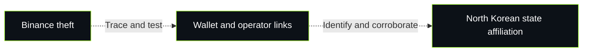

# North Korea attribution: evidence and uncertainty

**Assessment date: November 2, 2026 (America/Chicago).** This section evaluates the published attribution and identifies checks this study has not performed.

**Current conclusion:** the theft is officially attributed to North Korea and supported by published investigative findings. This study has not independently reproduced a complete attribution chain from the intrusion to identifiable operators and state affiliation. The FBI's public alert states its conclusion without publishing the complete underlying evidentiary basis. [FBI attribution](https://www.fbi.gov/investigate/cyber/alerts/2026/north-korea-responsible-for-6-billion-binance-attack)

## The links that require separate evidence

The diagram maps questions for verification. A transaction can establish a transfer; interpreting custody, common control, operator identity and state affiliation requires additional evidence. A laundering connection may concern a different participant from the initial intruder.

## What the public record supports

| Evidence | Published finding | Boundary |
|---|---|---|
| [FBI alert](https://www.fbi.gov/investigate/cyber/alerts/2026/north-korea-responsible-for-6-billion-binance-attack) | Attributes the theft to North Korea's TraderTraitor activity. | Establishes the official position; the alert does not expose the full attribution case for public replication. |
| [Chainalysis](https://www.chainalysis.com/blog/binance-exploit-latest-findings-and-response/) | Reports Binance proceeds commingling with Bitget proceeds. | Supports an operational relationship; common intruder identity needs further support. |
| [BitOK](https://bitok.org/blog/binance-hack-bitok-investigation) | Identifies a shared Ethereum recipient and two sets of attributed cross-chain payouts. | A specific replay candidate; this project has not verified those mappings. |
| [TRM Labs](https://www.trmlabs.com/resources/blog/north-korea-steals-usd-6-36-billion-from-binance-in-the-largest-hack-in-history) | Expresses high confidence using on-chain and off-chain intelligence. | The complete off-chain basis is not disclosed in the article. |
| [Elliptic](https://www.elliptic.co/insights/binance-largest-hack-in-history/) | Reports overlapping laundering activity and similarities with earlier attributed operations. | Multiple reports may share observations or prior address labels. |

## The strongest concrete verification lead

BitOK identifies recipient `0x15104a9ce0f08a8f0075a0869ae80e795fe0feb7`. It reports eight Bitget-linked payouts totaling 349.46 ETH and five Binance-linked payouts totaling 13.63 ETH by October 30 at 06:20 UTC. The stated overlap occurs during laundering. We have reviewed that report, not independently reconstructed the transfers. [A03](https://bitok.org/blog/binance-hack-bitok-investigation)

The next check is to recover each transaction hash and cross-chain correspondence, validate the originating theft labels, and establish whether the recipient is a private wallet or a service. Matching totals alone would not validate the entire path. The [verification plan](verification-plan.md) records these steps and the missing evidence.

## Where error or interpretation can enter

- **Shared service versus shared intruder.** A common laundering provider could serve different clients. The alternative requires testing custody and client relationships.
- **Inherited attribution.** A link to an earlier theft inherits uncertainty in that theft's actor labels. Elliptic described the Bitget link as highly likely and noted that the exchange's technical basis was unpublished. Its indexed September 25 account is preserved as an assessment. [A06](https://www.elliptic.co/insights/bitget-attack-pushes-suspected-north-korea-crypto-heists-over-1-billion-in-2026/)
- **Source dependence.** Elliptic credits ZachXBT with first reporting the Binance–Bitget connection. Agreement among reports is not automatically independent reproduction. [A04](https://www.elliptic.co/insights/binance-largest-hack-in-history/)
- **Ambiguous mappings.** Pooled services, bridge routing, address-label errors and unsolicited deposits must be excluded before inferring common control. These are audit checks proposed by this study, not findings that such errors occurred here.
- **Nonexclusive methods.** Familiar tools, timing or tactics can support an assessment without uniquely identifying a country. This is a limitation of inference, not evidence of a particular alternative attacker.

The [alternative-explanations table](alternative-explanations.csv) is a test framework. It does not assign equal probabilities to the possibilities or establish any alternative as fact. The [source-dependency map](source-dependencies.csv) records disclosed relationships and unknown independence.

## What would strengthen or change the conclusion

Evidence tying the transactions to operators could include endpoint and signing logs, validated infrastructure-control records, authenticated communications or lawfully disclosed account-identification records. A state-affiliation finding needs an evidenced connection beyond possession or movement of coins. These are evidence categories sought, not materials this project possesses.

The audit will upgrade a claim only when its basis is documented and reproducible at the stated level. A failed fund-flow reproduction, a service-controlled recipient or an incorrect prior actor label would require revising the affected link. Missing public disclosure limits independent verification; it does not by itself demonstrate that the official attribution is wrong.

## Audit record and references

- [Evidence register](evidence-register.csv): separates published claims, this project's checks and unresolved questions.
- [Source-dependency map](source-dependencies.csv): avoids counting repeated observations as independent confirmations.
- [Alternative explanations](alternative-explanations.csv): records tests and evidence needed.
- [Verification plan](verification-plan.md): candidate transaction replay and attribution checks; no completed replay is claimed.

References A01–A05 were read as publisher-page text. A06's primary-publisher text was available in indexed search results; a direct request returned 404 during this review. That access result does not establish a retraction. These IDs map to existing sources or new references in the [main source index](../SOURCES.md#attribution-audit-references).

[Study overview](../README.md) · [November 2 update](../updates/2026-11-02/README.md) · [Original dossier](../research/DOSSIER.md)
