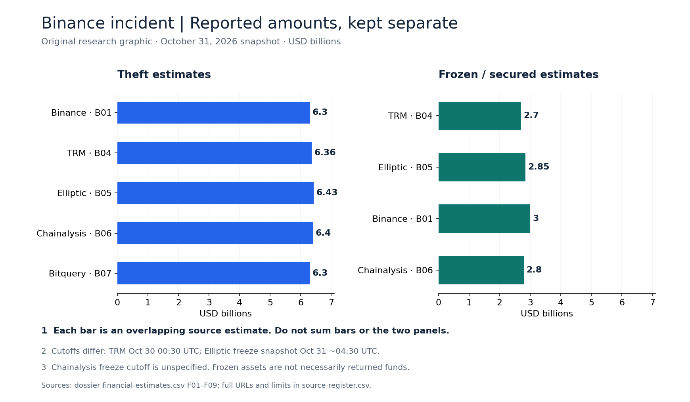
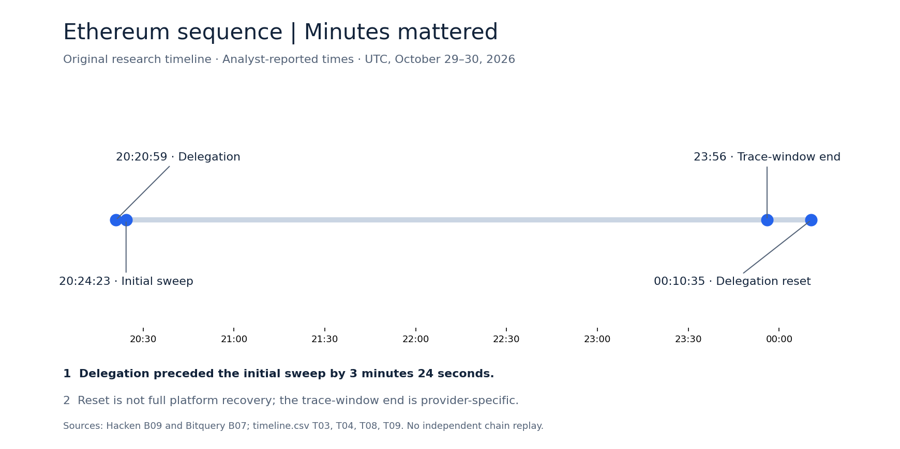
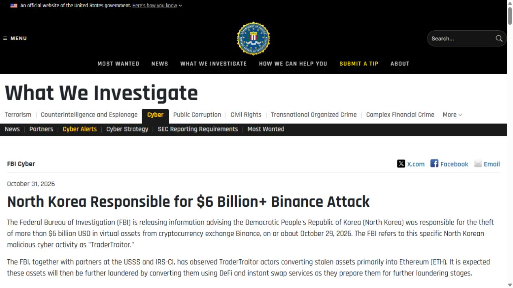
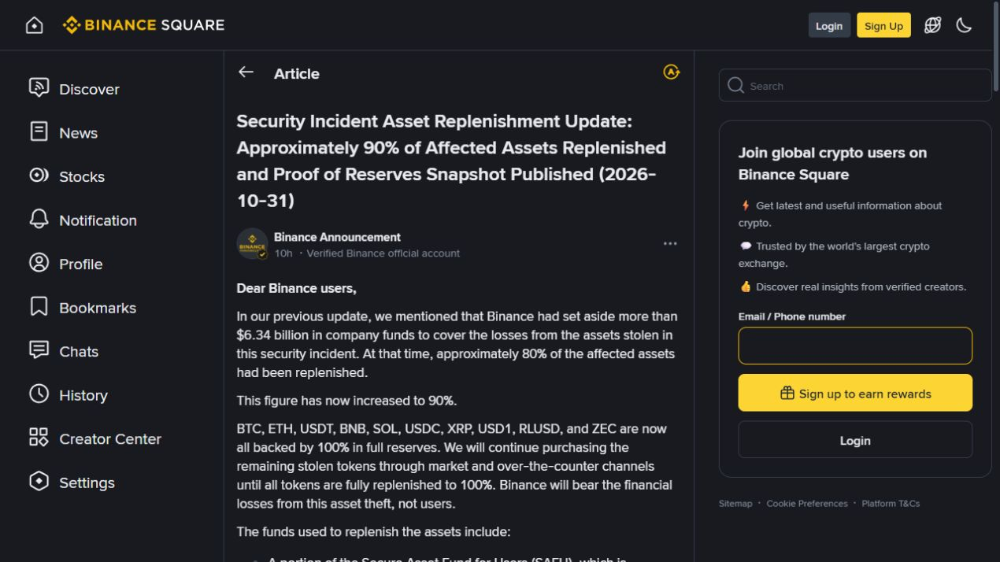

# Binance hot-wallet theft: research dossier

**Incident:** October 29, 2026 UTC. **Research snapshot:** October 31, 2026, America/Chicago. **Latest dated source update inspected:** October 31, 23:55 UTC (18:55 CDT), in Elliptic's article. This is a static research record, not live monitoring.

## Assessment

Binance acknowledges a major hot-wallet theft and promises to absorb user losses. The FBI publicly attributes the theft to North Korea's TraderTraitor activity. Investigators reconstruct unauthorized withdrawals across multiple chains, with Ethereum account delegation as one component. The exact internal intrusion and authorization failures remain unresolved.

The most important distinctions are **theft versus current attacker balances**, **freezing versus recovery**, **replacement funding versus returned stolen assets**, and **automation versus demonstrated AI involvement**. This dossier preserves source-specific figures rather than asserting one reconciled accounting.

Navigate: [timeline](timeline.csv), [reported financial estimates](financial-estimates.csv), [claim audit](claim-audit.csv), [source register](source-register.csv), [reading guide and limitations](README.md).

## Visual evidence

[Open all six visuals with annotations, subtitles and capture provenance](VISUAL-EVIDENCE.md).

*V04 — Original research graphic. Estimates overlap; cutoffs differ. Frozen does not mean returned. Data: financial-estimates.csv F01–F09.*

## 1. Scope and status of the incident

Binance dates onset to **04:05 UTC+8 October 30 / 20:05 UTC October 29 / 15:05 CDT October 29**. It reports additional compromise points beyond a laptop and no evidence of private-key compromise. These are provisional findings. [B01](https://www.binance.com/en/square/post/382966352206379)

The early report described a DevOps laptop allowing access to a service container and unauthorized withdrawal submission. Direct access to that initial Square post returned a page shell; its indexed text is retained as provisional context. The expanded later account controls the current description. [B15](https://www.binance.com/en/square/post/382967851743776)

A hot wallet is an online account used to service withdrawals. Losing control of its signing workflow can permit transfers even if a private key is not exported. That interpretation is consistent with the observed transactions, but the transaction record alone cannot identify the internal failure.

## 2. Source-specific financial accounting

| Reporter | Reported amount | Meaning and cutoff |
|---|---:|---|
| Binance | $6.3B | Company impact estimate, update #2 |
| TRM | $6.36B | Theft across ten chains; observations through Oct 30 00:30 UTC |
| Elliptic | $6.43B | Theft across eleven chains; theft-time transfer valuations |
| Chainalysis | ~$6.4B | Unauthorized transfers; publication Oct 30 |
| Bitquery | ~$6.3B | Seventeen hot wallets across nine chains; updated trace Oct 31 |

Sources: [B01](https://www.binance.com/en/square/post/382966352206379), [B04](https://www.trmlabs.com/resources/blog/north-korea-steals-usd-6-36-billion-from-binance-in-the-largest-hack-in-history), [B05](https://www.elliptic.co/insights/binance-largest-hack-in-history/), [B06](https://www.chainalysis.com/blog/binance-exploit-latest-findings-and-response/), [B07](https://www.bitquery.io/investigations/binance-hack).

These estimates overlap. Do not add them or average them. Differences can reflect covered chains, address labels, token prices, update timing and treatment of internal movements. A complete transaction-level reconciliation has not been performed here.

### Frozen and seized assets

TRM's early snapshot estimates roughly **$2.7B** frozen, including stablecoins and an Arbitrum intervention. Elliptic's later accounting reports **$2.85B**, using current prices around **04:30 UTC October 31**, excluding an Aave collateral/debt position. Binance reports approximately **$3B**. Chainalysis reports about **$2.8B**, but the inspected article leaves its exact cutoff as a literal “[time] ET” placeholder. [B04](https://www.trmlabs.com/resources/blog/north-korea-steals-usd-6-36-billion-from-binance-in-the-largest-hack-in-history), [B05](https://www.elliptic.co/insights/binance-largest-hack-in-history/), [B01](https://www.binance.com/en/square/post/382966352206379), [B06](https://www.chainalysis.com/blog/binance-exploit-latest-findings-and-response/)

A freeze restricts movement; it does not by itself transfer ownership or return assets. CoinDesk's expert interviews explain that restitution still requires establishing entitlement and an appropriate legal or issuer process. They also raise questions about consistent treatment of smaller victims. This is reported commentary, not a legal conclusion for every jurisdiction. [B13](https://www.coindesk.com/business/2026/10/30/experts-divided-over-binance-hack-asset-freezes-warn-recovery-is-another-matter)

### Attacker holdings and transaction costs

Bitquery's October 31 **16:51 UTC** snapshot estimates **$3.1B** still held by attacker-linked wallets and **525,201 ETH** after swaps. These balances are not the original stolen token quantities and cannot simply be subtracted from a theft-time dollar total. [B07](https://www.bitquery.io/investigations/binance-hack)

In a separate trading study, Bitquery estimates **$119M** of execution losses against contemporaneous market prices, including $71.5M from buying ETH, $24.8M from selling tokens and $22.4M from buying TRX. It estimates arbitrage participants retained $59.9M after costs and builders/validators received $29.5M. These are overlapping aspects of execution economics, not additional victim compensation; some small tokens lack reliable benchmarks. [B08](https://www.bitquery.io/investigations/binance-hack-who-profited)

## 3. Attack mechanics: what the evidence can and cannot show

### Multi-chain activity

TRM observes that most funds moved within roughly twenty minutes, followed by a later wave. Its interpretation is compromise of hot-wallet signing infrastructure: Ethereum delegation and ordinary signed transfers on other chains are difficult to explain as an Ethereum-only problem. That remains an investigator assessment, not proof of the precise route into Binance. [B04](https://www.trmlabs.com/resources/blog/north-korea-steals-usd-6-36-billion-from-binance-in-the-largest-hack-in-history)

### Ethereum delegation

EIP-7702 allows an externally owned account to authorize execution of code at a delegate address. Authorization includes chain and nonce checks; delegation can persist until changed. This is not, by definition, a multisignature protocol. The specification warns that delegated code has extensive account access and requires careful security review. [B10](https://eips.ethereum.org/EIPS/eip-7702)

Hacken reconstructs a delegation at **20:20:59 UTC**, an initial large sweep at **20:24:23**, and a reset at **00:10:35 UTC October 30**. It describes 50 authorizations over consecutive nonce values, one matching the account's state. Later sweeps reached subsequently arriving assets. These timings are analyst-reported; this archive did not replay the chain. [B09](https://hacken.io/insights/binance-hack/)

A linked initial sweep transaction is available for follow-up: [Ethereum transaction record](https://etherscan.io/tx/0x53bd38b816c23e74134786c29a8c18d792777998a3b9326047b583100e88e2f3). Its direct explorer retrieval was blocked during this review, so the reference is not presented as independently inspected evidence.

*V05 — Elapsed UTC time; analyst reconstructions. Reset does not imply full recovery. [Data and annotations](VISUAL-EVIDENCE.md#v05--ethereum-sequence).*

### Valid signatures are not proof of legitimate intent

The forensic question is whether an attacker obtained keys, induced the legitimate signer to approve malicious transactions, bypassed authorization controls, or combined routes. Binance's “no evidence” of key compromise does not establish that all signing controls worked. Likewise, valid signatures do not prove a key was extracted.

This distinction is analytical: on-chain evidence establishes account actions and signatures; endpoint, access, signing-policy and approval logs are needed to determine the off-chain chain of authority. An Ethereum-specific delegation mechanism also cannot, alone, explain other chains' valid transfers.

## 4. Attribution and laundering

### Official attribution

*V01 — Source-page capture, October 31 at 20:10 CDT. The notice records official attribution, not a complete technical postmortem. [Source and capture notes](VISUAL-EVIDENCE.md#v01--official-attribution).*

On October 31, the **FBI attributed more than $6B stolen on or about October 29 to North Korea**, naming the activity **TraderTraitor**. It says the FBI, USSS and IRS-CI observed conversion primarily into ETH and anticipated further DeFi/instant-swap laundering. The alert requests transaction blocking and provides an address list. Government attribution is stronger than an unattributed rumor, but its full evidentiary basis is not public in the alert. [B03](https://www.fbi.gov/investigate/cyber/alerts/2026/north-korea-responsible-for-6-billion-binance-attack)

### Investigators' grounds

Chainalysis attributes the theft to TraderTraitor based in part on **commingling with funds from the prior Bitget theft**. It also describes rapid stablecoin-to-ETH swaps and repeated transaction patterns, including addresses receiving exactly 1 TRX before further transfers. These support an inference of programmatic activity; they are not public proof of the internal compromise method. [B06](https://www.chainalysis.com/blog/binance-exploit-latest-findings-and-response/)

### Can the assets still be stopped?

Issuer-controlled tokens can have freeze functions, while native assets lack that same issuer control. Exchanges may still identify and block deposits of native assets. Governance interventions are another mechanism and should not be conflated with ordinary token freezes. The FBI's address list and the investigators' screening resources are useful starting points, but their labels and coverage can change.

No immutable blacklist is copied here. Consult the current official alert and investigator resources; an address being linked to the case is a source assertion that must retain its provenance. [B03](https://www.fbi.gov/investigate/cyber/alerts/2026/north-korea-responsible-for-6-billion-binance-attack)

## 5. Was AI involved?

**Not established as a technical cause or autonomous attacker in the reviewed evidence.** Elliptic explicitly says on-chain automation cannot determine whether AI agents or conventional scripts are responsible. It discusses possible indicators but does not report clear proof of them. [B05](https://www.elliptic.co/insights/binance-largest-hack-in-history/)

Distinguish four questions: Was AI used for initial access? For attack planning? For executing transactions? For laundering or defensive investigation? Evidence for one does not prove the others. High volume, coordinated timing and automated transfers alone do not establish an AI agent.

Chainalysis has a separate security incident with an asserted agentic element. Its own notice says that incident is **unrelated to the Binance theft**. The shared publication period must not be turned into evidence of causation. [B16](https://www.chainalysis.com/blog/security-incident-october-30/)

## 6. Binance response, replacement funds and service restoration

### Initial containment and funding

Update #2 describes containment and a withdrawal pause, with **$6.34B-plus** prepared and about **80%** replenishment. It promises loss coverage and phased restoration. Its heading says October 30 while its signature says October 31. [B01](https://www.binance.com/en/square/post/382966352206379)

### October 31 replenishment update

*V02 — Binance's own replenishment statement. Replacement funding is different from funds recovered from the attacker. [Source and caption](VISUAL-EVIDENCE.md#v02--binances-replenishment-claim).*

The later verified post reports **90% replenishment**, ten fully backed assets and a less-liquid remainder. Funding includes SAFU, the Futures Insurance Fund and company money. No independent balance-sheet audit was conducted here. [B02](https://www.binance.com/en/square/post/383244329941551)

Reuters also reports that replacement was financed by purchases using company money, with the remaining assets taking longer to buy. Its reporting corroborates the public statement's existence, not the completeness of reserves or customer reimbursement. [B12](https://live.euronext.com/en/financial-news/binance-says-it-has-covered-90-losses-63-billion-hack)

### Snapshot, complete proof and calendar conflicts

The reserve snapshot is **00:00 UTC October 31 / 19:00 CDT October 30**. Complete proof is separately targeted for **November 3 UTC**, versus **November 2** earlier. The stated 40–50-hour generation duration and later calendar date need reconciliation. [B02](https://www.binance.com/en/square/post/383244329941551), [B01](https://www.binance.com/en/square/post/382966352206379)

A captured reserve snapshot is not the same event as publication and verification of a complete proof. Inclusion of balances in a proof also does not by itself establish all liabilities, liquidity, encumbrances or operational readiness. These are analytical limits of what this archive verified.

The withdrawal target is **Sunday, November 1**; completion is not verified in this snapshot. [B02](https://www.binance.com/en/square/post/383244329941551)

### Regional customer impact

Binance Japan says its customer assets are separately held in cold wallets and were not affected, while crypto withdrawals were paused as a precaution. Its notice says crypto deposits, trading and fiat deposits/withdrawals remained available, and gives a provisional 48-hour restoration expectation. This illustrates that a pause is not itself proof of asset loss. Do not generalize the Japan statement to every Binance legal entity. [B11](https://www.binance.com/en/square/post/382812261202623)

## 7. Claims that need careful wording

| Claim | Assessment in this snapshot |
|---|---|
| “Binance was hacked” | Acknowledged by Binance and supported by multiple investigator accounts |
| “It was only one employee's laptop” | Incomplete; expanded company account identifies additional compromise points |
| “No private keys were compromised” | Company reports no evidence; not a universal forensic proof |
| “Ethereum encryption failed” | Not established; evidence concerns authorization and account control |
| “EIP-7702 is multisig” | Incorrect description of the specification |
| “All stolen assets have been recovered” | Not supported; freezing and replenishment are different processes |
| “90% replenished means 90% retrieved from hackers” | Not supported by the company's funding explanation |
| “Withdrawals are already fully restored” | Not established in reviewed October 31 material |
| “AI autonomously performed the hack” | Unproven |
| “North Korea attribution is only speculation” | Outdated after the October 31 FBI alert |
| “Every source's loss figure is directly comparable” | Incorrect; scope, prices and cutoffs differ |

The machine-readable [claim audit](claim-audit.csv) attaches source IDs and status boundaries. These assessments are research judgments, not new forensic findings.

## 8. Market reporting and scale

AP's initial account reported bitcoin falling 3.2% to below $79,000 during the developing story. This is a contemporaneous price observation, not proof that the hack caused every market movement, nor a closing-price series. [Early AP report](https://apnews.com/article/39cda8ceb8095e036334a18549d3d20d)

Investigators describe this as the largest crypto theft recorded in their comparisons. Broader claims about the largest theft of any kind depend on historical definitions and valuation; this archive uses the narrower crypto-incident description.

## 9. Open questions and evidence needed

- **Initial access:** endpoint compromise method, dwell time, identities involved and exact additional compromise points.
- **Authorization:** signing-policy logs, approval and role boundaries, transaction simulation, key custody, and whether delegation requests were permitted by design.
- **Containment:** when each internal team and issuer learned of the incident; publication and block timestamps cannot alone measure response diligence.
- **Complete inventory:** transaction-level chain/token list, address-label revisions, valuation timestamps, internal transfers and treatment of pledged collateral.
- **Recovery:** which frozen assets have actually been returned, legal orders or issuer actions used, and any remaining contested ownership.
- **Replenishment:** allocation among funding sources, post-event reserve verification, liabilities/encumbrances and ability to service withdrawals.
- **Customer harm:** access delays, direct or indirect losses, geographic differences and any final compensation criteria.
- **AI attribution:** model/tool evidence, agent traces or independently corroborated operator details.
- **Public postmortem:** final internal attack sequence, externally validated remediation and outstanding risks.

These are follow-up research questions, not assertions that every listed failure occurred.

## 10. Research limitations and update rules

This dossier combines owner statements, a government alert, original blockchain investigations, protocol documentation and selected independent reporting. It does not claim every web article was found. Duplicate syndications are not independent corroboration.

No private incident logs, internal Binance systems or paid forensic datasets were accessed. No independent chain replay, token-balance audit, reserve-proof verification or forensic attribution was performed. Direct explorer retrieval was blocked; some initial owner material was accessible only through indexed text. Source pages are mutable, and updates can supersede earlier descriptions.

For future updates, preserve the old observation, append the new date and source, and distinguish revision from contradiction. Never convert a restoration target into completion without a confirming notice. Never combine theft-time value, current balances, frozen tokens and replacement purchases into one total without a reconciliation.

This public edition preserves the October 31 research snapshot. See the [publication record](../PUBLICATION.md) for scope, source-access notes and asset provenance. AI involvement remains unconfirmed in this archived evidence.
