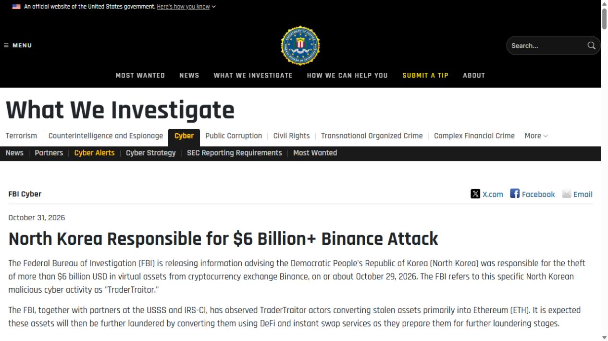
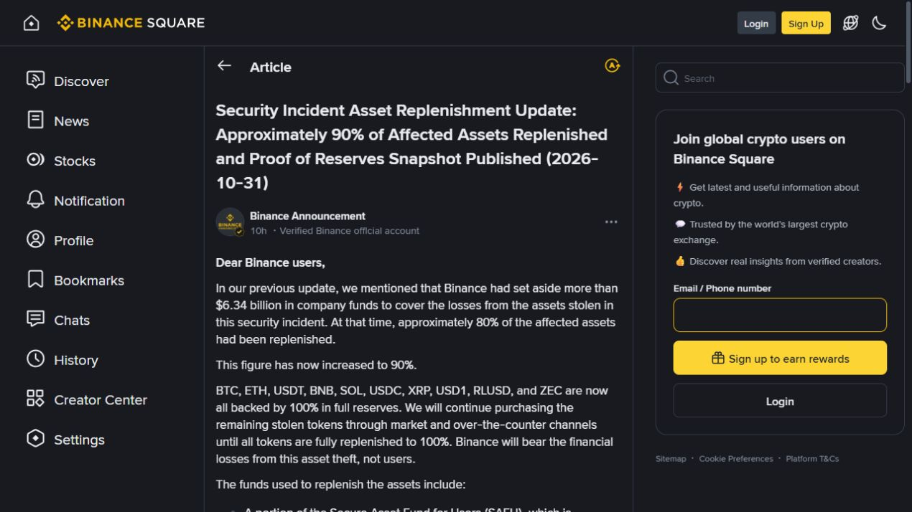
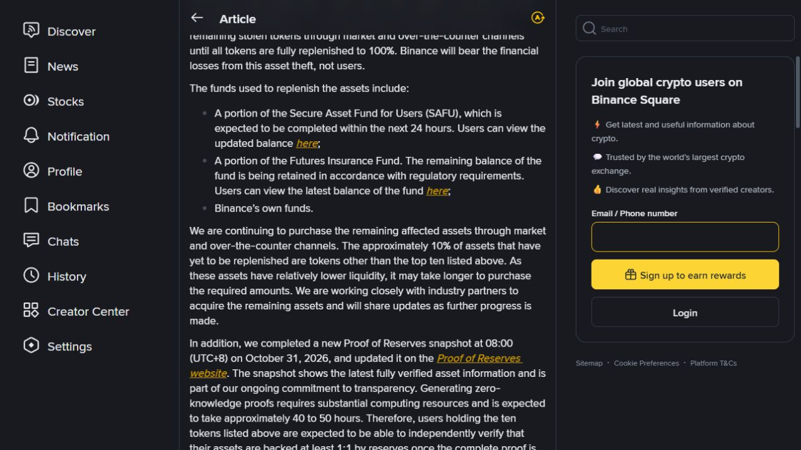
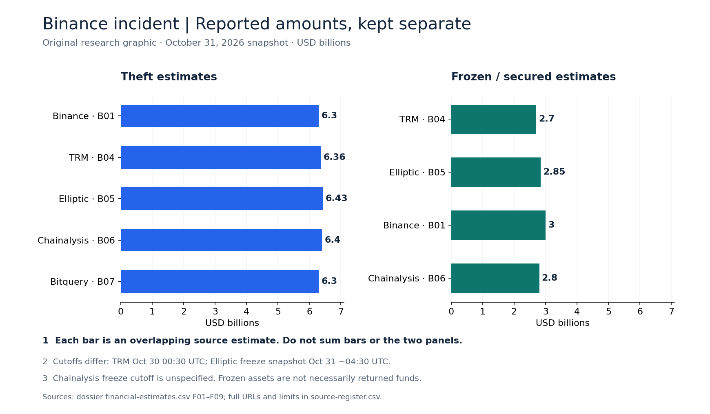
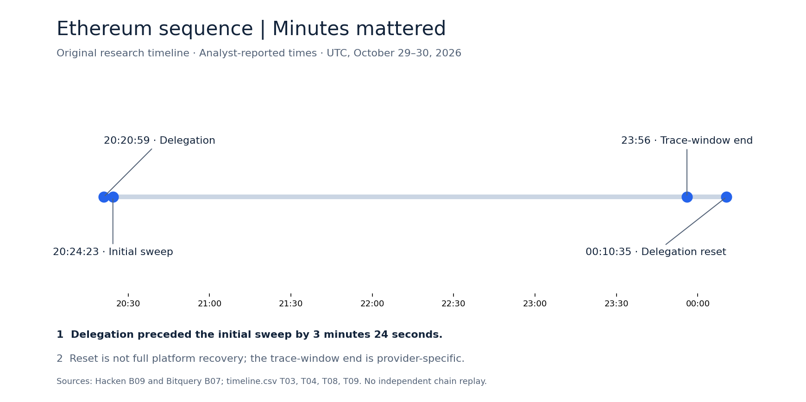
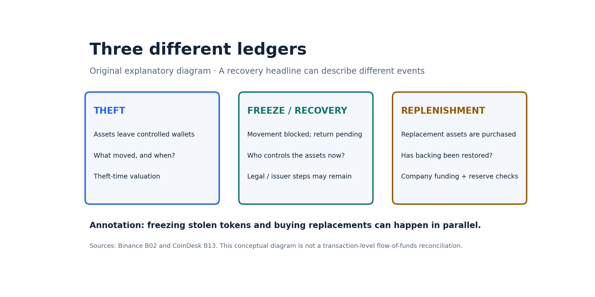

# Annotated visual evidence — Binance, October 2026

**Research snapshot:** October 31, 2026. **Captures:** October 31 at approximately 20:10 CDT (November 1, approximately 01:10 UTC).

Source screenshots are authentic browser viewport captures made during this research session, not captures taken during the attack. The screenshots remain unchanged; explanatory annotations and subtitles appear below them. Original charts are separately labeled and are not screenshots of third-party publications.

## V01 — Official attribution

**Subtitle:** The FBI's October 31 notice attributes the theft to North Korea's TraderTraitor activity.  
**Annotation:** This records an official public assessment. It does not disclose the full intelligence behind attribution or prove the internal intrusion route.  
**Source:** [FBI alert](https://www.fbi.gov/investigate/cyber/alerts/2026/north-korea-responsible-for-6-billion-binance-attack) · dossier source B03 · capture 20:10:25 CDT. The viewport includes the publisher identity, publication date and substantive opening.

## V02 — Binance's replenishment claim

**Subtitle:** Binance reports replacement progress; this is not a report that 90% was retrieved from the attacker.  
**Annotation:** The account's verification label and dated article heading are visible. The assertion is Binance's own statement, not an independent reserve audit. Relative age, prices, reactions and view counts are incidental dynamic page content.  
**Source:** [Verified Binance post](https://www.binance.com/en/square/post/383244329941551) · B02 · capture 20:10:40 CDT.

## V03 — Funding detail in the same post

**Subtitle:** The post identifies funding sources for replacement purchases.  
**Annotation:** This is a scrolled viewport of V02's page. It must be read with V02 for publisher and title context. It is not a separate announcement, and does not establish that frozen stolen assets were returned.  
**Source:** [Same Binance post](https://www.binance.com/en/square/post/383244329941551) · B02 · capture 20:10:48 CDT.

## V04 — Loss and freeze estimates

**Subtitle:** Multiple estimates describe overlapping assets with different observation and valuation bases.  
**Annotations:** Both panels start at zero and use the same unit. Do not sum the bars, subtract unmatched cutoffs, or read the right panel as completed restitution. The graphic labels original dossier source IDs.  
**Data:** [Financial estimates](financial-estimates.csv), F01–F09. Source URLs and caveats are in the [source register](source-register.csv). [Vector version](assets/reported-amounts.svg).

## V05 — Ethereum sequence

**Subtitle:** A short interval separated delegation and the initial sweep; the reset occurred hours later.  
**Annotations:** Point spacing follows elapsed UTC time. The trace-window endpoint comes from Bitquery, while delegation, sweep and reset times come from Hacken. These are reported reconstructions, not an independently replayed chain trace. Reset does not mean platform-wide recovery.  
**Data:** [Timeline](timeline.csv), T03, T04, T08, T09; sources B07 and B09. [Vector version](assets/ethereum-sequence.svg).

## V06 — Three different ledgers

**Subtitle:** Asset control and replacement funding are separate accounting questions.  
**Annotation:** This explanatory diagram describes concepts, not measured transaction flows. Freezing and replenishment can happen in parallel; the drawing does not assert that one returned the value of the other.  
**Sources:** Binance B02 and CoinDesk B13, linked in the [source register](source-register.csv). [Vector version](assets/three-ledgers.svg).

## Capture integrity and reuse

The [asset manifest](visual-manifest.json) records source URLs, source IDs, byte sizes, SHA-256 hashes, creation/capture timestamps, image type and transformation status. Raw source captures have no overlaid arrows, rewritten text, redactions or synthetic elements.

Third-party page design, branding and content retain their respective rights. These limited viewport excerpts are retained as contextual evidence in this dated research archive; no entire article or full-page reproduction is included. Charts and diagrams are original research graphics based on the archive's cited observations.

Browser screenshots establish what the rendered page displayed at capture time. They do not independently authenticate the underlying claims, prove an earlier page state, or supersede later corrections. The financial and timeline files remain the structured record.

Return to the [dossier](DOSSIER.md) or [case overview](README.md).
